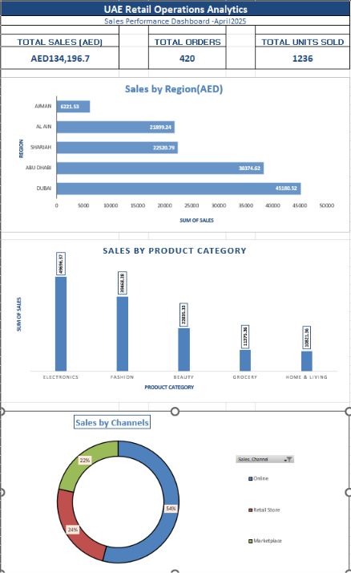

# uae-retail-operations-analytics
A beginner data analytics project exploring UAE retail sales, profitability, delivery performance, and data quality using Excel.

## Dashboard Preview

## Project Overview

An Excel-based retail operations analytics project using 420 synthetic order records to explore sales performance, order volumes, product categories, regions, and sales channels.

## Tools Used

- Microsoft Excel
- PivotTables and PivotCharts
- Excel formulas and data-quality checks
- KPI dashboard design

## Key Metrics

- **Total Sales:** AED 134,196.70
- **Total Orders:** 420
- **Units Sold:** 1,236

## Data Quality Findings

- 112 customer ratings are missing.
- One customer rating is outside the expected 1–5 range.
- One cancelled order records sales despite having zero units.

The dataset is synthetic and intended for portfolio demonstration. The findings do not represent a real company's performance.
